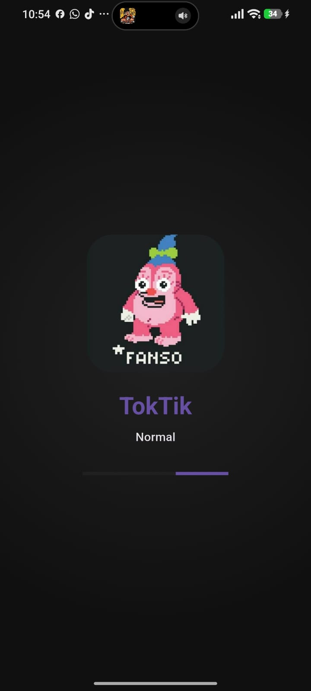
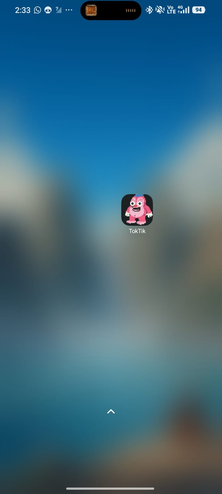
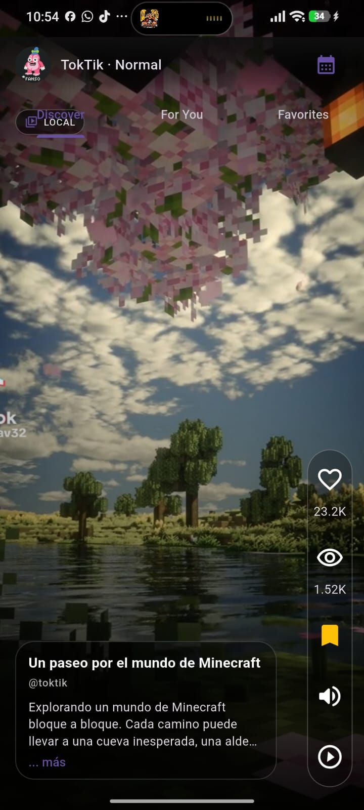
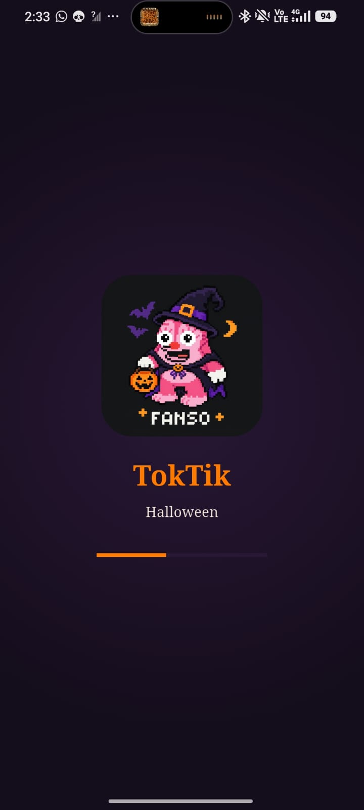
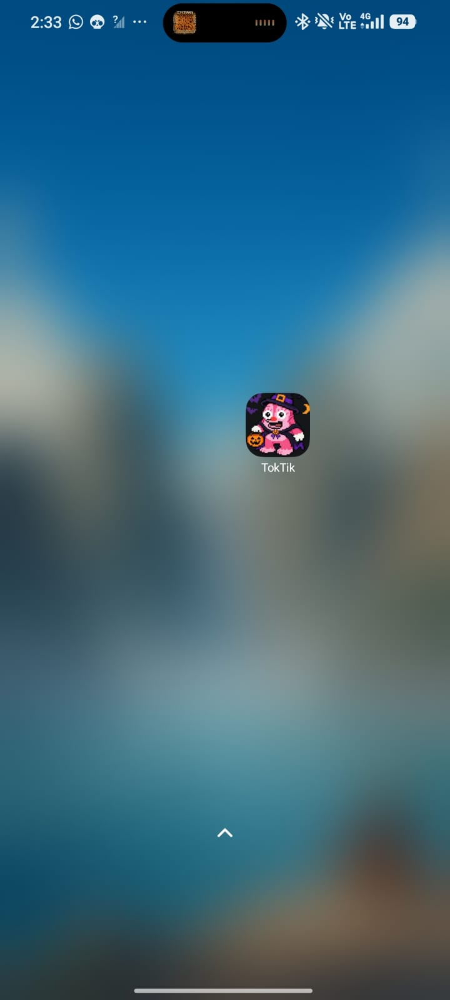
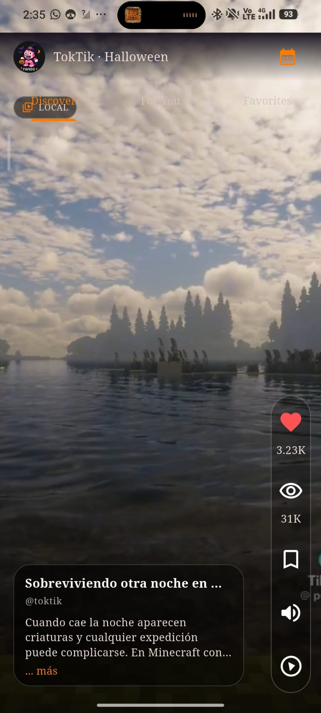
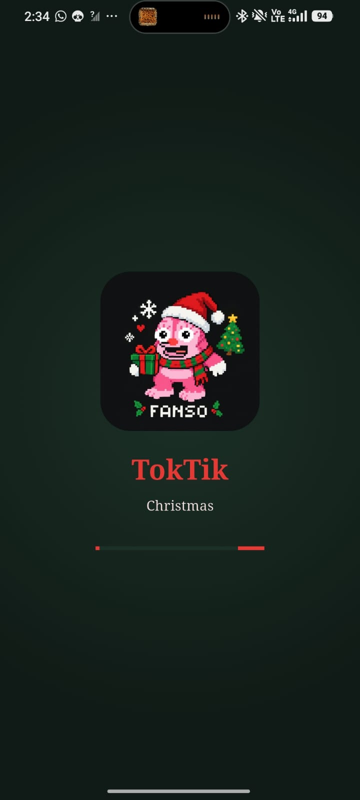
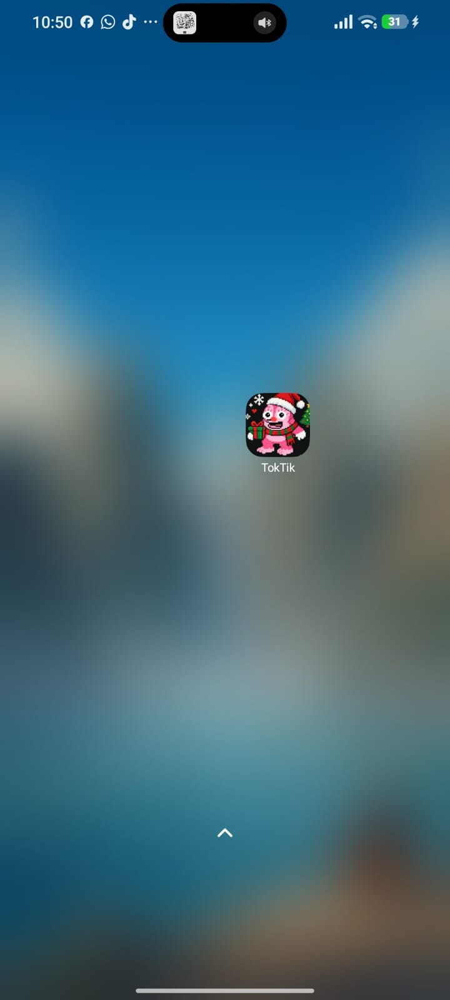
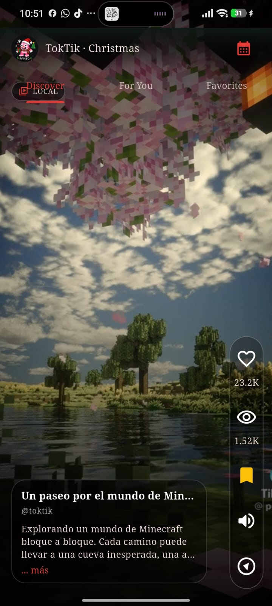

# TokTik

TokTik es una aplicación móvil desarrollada con Flutter para explorar videos en
formato vertical. La práctica reúne un feed de videos, secciones para descubrir
contenido, preferencias guardadas localmente y una interfaz que cambia de
apariencia según la temporada.

## Funcionalidades

- **Secciones de contenido:** *Discover*, *For You* y *Favorites*. Desliza
  verticalmente para cambiar de video y horizontalmente para cambiar de sección.
- **Videos locales y en línea:** *Discover* y *For You* incluyen ocho videos
    de cada proveedor: ` Tik Tok , YouTube, Vimeo y
  Dailymotion.` *For You* ordena el contenido disponible según la interacción;
  *Discover* conserva el orden de origen.
- **Interacciones:** permite dar y quitar Me gusta, guardar favoritos y
  consultar las reproducciones. Los Me gusta, sus conteos y los favoritos se
  conservan en las preferencias del dispositivo.
- **Reproducción:** toca el video para mostrar los controles de reproducción y
  volumen. El audio inicia habilitado; puedes silenciarlo desde el control.
- **Descripciones:** usa **... más** para expandir una descripción larga y
  desplázate por el texto expandido.
- **Temas de temporada:** el tema, el logotipo, la paleta, la tipografía y el
  sonido cambian según la fecha del dispositivo: San Valentín del 1 al 14 de
  febrero, Halloween durante octubre y Navidad durante diciembre. El resto del
  año se muestra el tema normal.
- **Fecha de prueba:** usa el icono de calendario en el encabezado para simular
  una fecha y probar otro tema. La selección se guarda en las preferencias del
  dispositivo y permanece después de cerrar la app. Elige **Use device date**
  para quitar la fecha simulada.

Al iniciar, la pantalla de bienvenida presenta el logotipo de la temporada y
reproduce su sonido. El feed comienza a cargar al abrir *Discover*; los sonidos
normales y de San Valentín se generan en la app.

## Fases visuales

El tema se determina usando la fecha del dispositivo. Octubre activa la fase
**Halloween**, diciembre la fase **Navidad** y las fechas restantes usan la fase
**Normal**, excepto del 1 al 14 de febrero, cuando se activa el tema de San
Valentín. Los logotipos disponibles para las tres fases documentadas están en
`assets/logos/`.

### Fase normal


Es el tema predeterminado: fondo oscuro, acentos morados y turquesa, tipografía
Roboto y el logotipo normal. Se utiliza fuera de las fechas de temporada.

| Pantalla de inicio | Icono instalado | Interfaz del feed |
|:--:|:--:|:--:|
|  |  |  |

### Fase Halloween


Se activa durante octubre. La interfaz usa tonos oscuros con acentos naranja y
violeta; el splash presenta el logotipo de Halloween y reproduce el sonido de
temporada.

| Pantalla de inicio | Icono instalado | Interfaz del feed |
|:--:|:--:|:--:|
|  |  |  |

### Fase Navidad


Se activa durante diciembre. Combina un fondo verde oscuro con acentos rojos y
verdes, y muestra el logotipo y la pantalla de inicio navideños.

| Pantalla de inicio | Icono instalado | Interfaz del feed |
|:--:|:--:|:--:|
|  |  |  |

## Video de demostración

El video muestra el funcionamiento de la aplicación y sus temas. El reproductor
usa el logotipo normal como portada; arriba se muestran los logotipos de cada
fase documentada.

<video controls width="640" poster="assets/logos/fanso_normal.jpg">
  <source src="assets/capturas/demostracion_funcionamiento.mp4" type="video/mp4">
  Tu navegador no puede reproducir el video. Puedes
  <a href="assets/capturas/demostracion_funcionamiento.mp4">abrir o descargar la demostración</a>.
</video>

[Abrir o descargar el video de demostración](assets/capturas/demostracion_funcionamiento.mp4).

## Requisitos y ejecución

Se requiere tener instalado Flutter y disponer de conexión a internet para
reproducir videos de YouTube, Vimeo y Dailymotion.

Desde esta carpeta (`Practica04/toktik`), ejecuta:

```sh
flutter pub get
flutter run
```

En las compilaciones web, los proveedores externos se reproducen con sus
reproductores oficiales incrustados para evitar restricciones CORS al resolver
streams directos. Las políticas de reproducción automática del navegador
pueden requerir tocar primero un video para que se reproduzca el audio.

## Recursos y estructura

- `assets/capturas/`: capturas de pantalla incluidas en este README.
- `assets/videos/`: videos locales del feed.
- `assets/logos/`: logotipos de las variantes normal, Halloween y Navidad.
- `assets/audios/`: sonidos de temporada disponibles.
- `lib/infrastructure/datasources/`: adaptadores de los proveedores de video.
- `lib/domain/`: contratos del feed y de las preferencias.
