# Widgets App — Práctica 05

Aplicación de Flutter para explorar widgets de Material 3, controles de
interfaz, navegación y manejo de estado con Riverpod.

[Ver diagrama de arquitectura](https://devfntxy.github.io/Practicas_DMI_230892/Practica05/diagrama/diagrama_arquitectura.html)

La captura del menú principal muestra las pantallas disponibles en la aplicación:

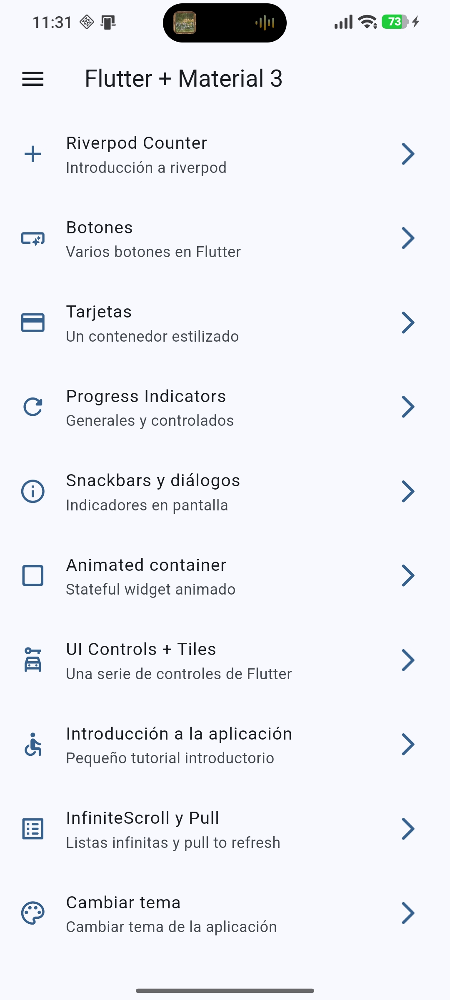

## Funcionalidades

La pantalla principal presenta un menú para abrir las siguientes demostraciones:

- **Riverpod Counter:** contador inicializado en 5, cuyo valor se incrementa
  mediante un botón flotante.

  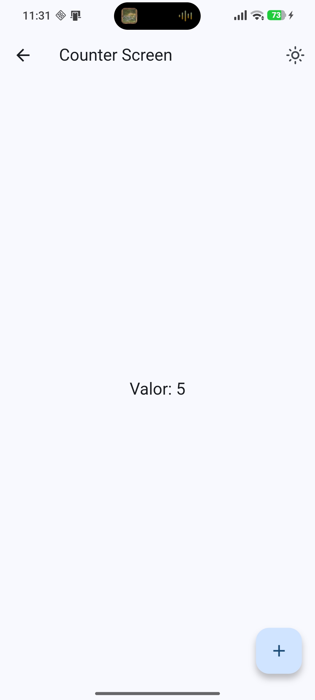

- **Botones:** ejemplos de botones Elevated, Filled, Outlined, Text e Icon, así
  como un botón personalizado.

  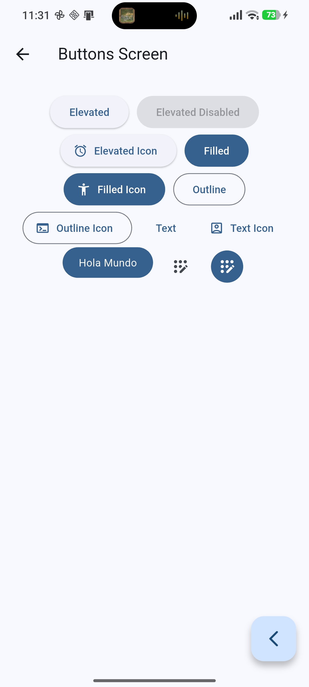

- **Tarjetas:** distintos estilos de `Card` con niveles de elevación de 0 a 5,
  contornos y superficies rellenas. Una variante carga imágenes desde Internet.

  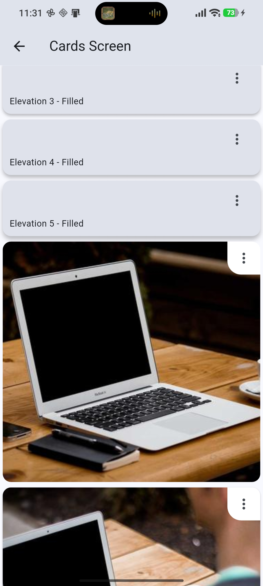

- **Indicadores de progreso:** indicador circular indeterminado y versiones
  circular y lineal con progreso animado.

  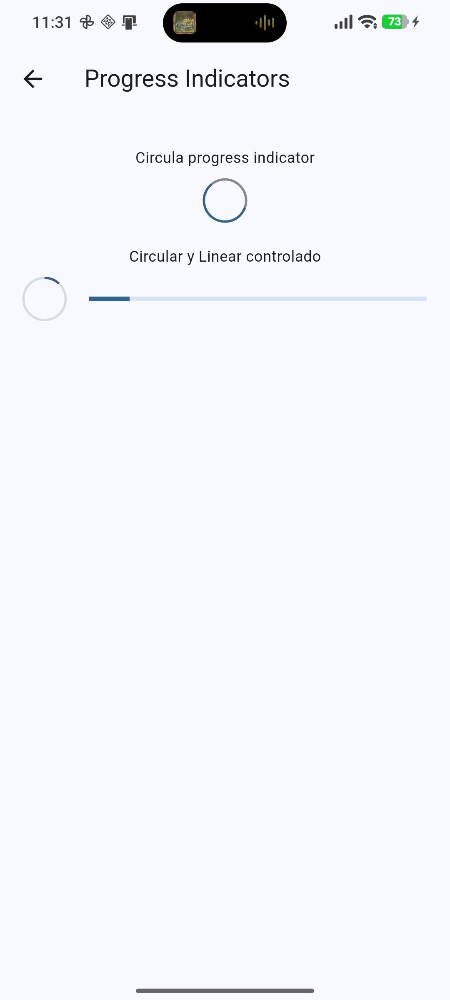

- **Snackbars y diálogos:** muestra una Snackbar, un diálogo de confirmación y
  el diálogo de licencias.

  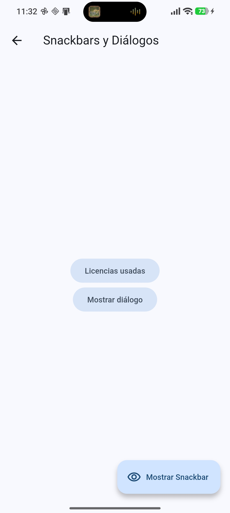
  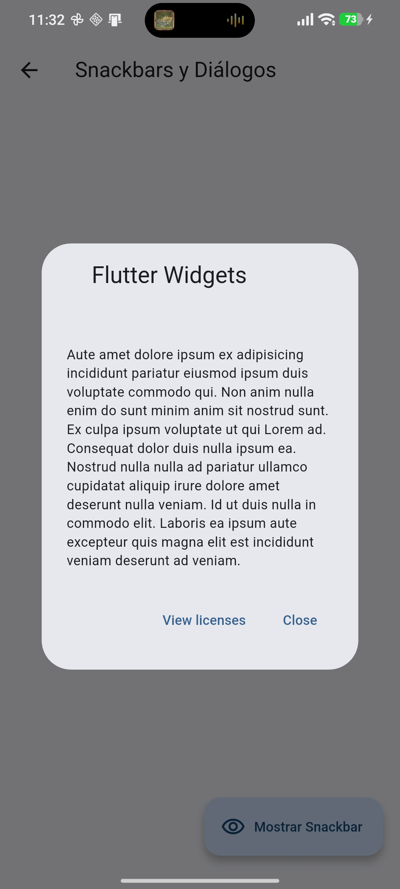

- **Animated Container:** cambia aleatoriamente el tamaño, el color y el radio
  de las esquinas con una transición animada.

  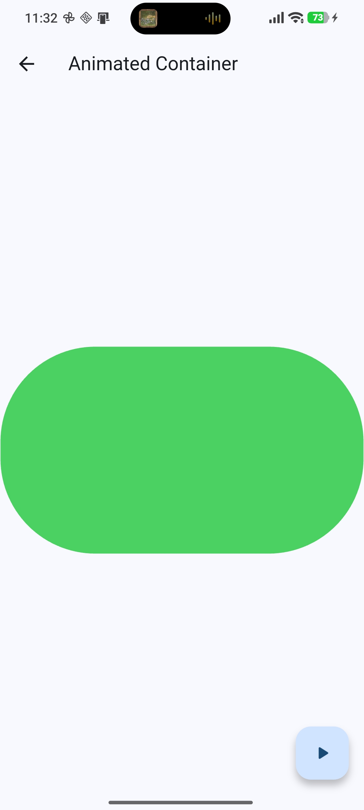
  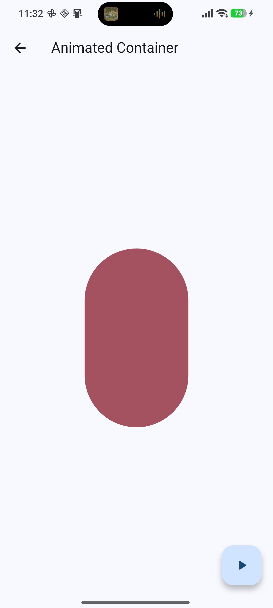

- **UI Controls:** ejemplos de `SwitchListTile`, `ExpansionTile`,
  `RadioListTile` y `CheckboxListTile`.

  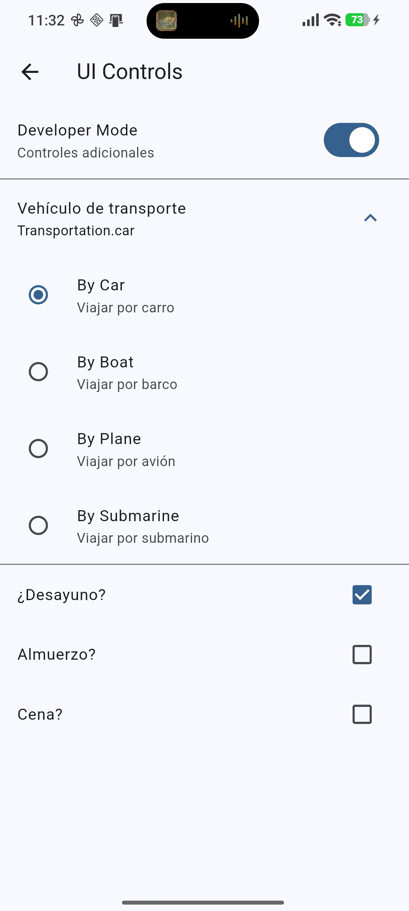

- **Tutorial introductorio:** carrusel de tres páginas que permite salir o
  continuar al llegar al final.

  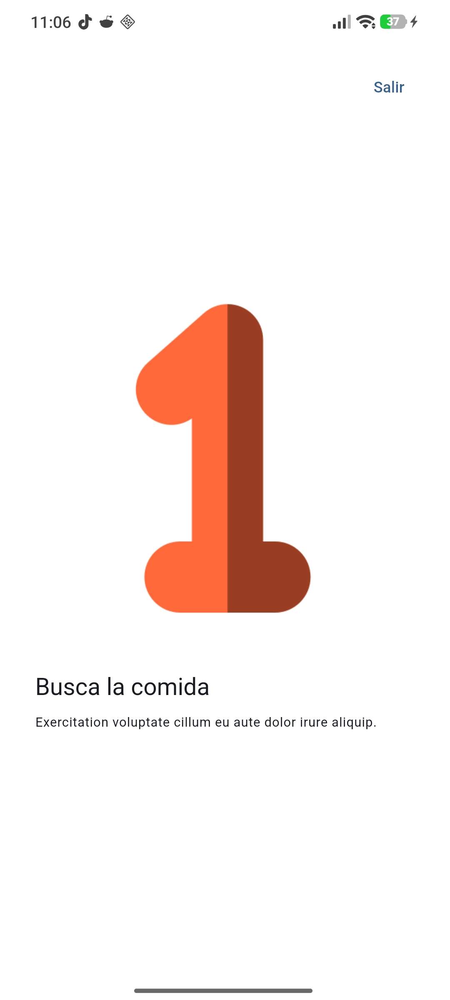
  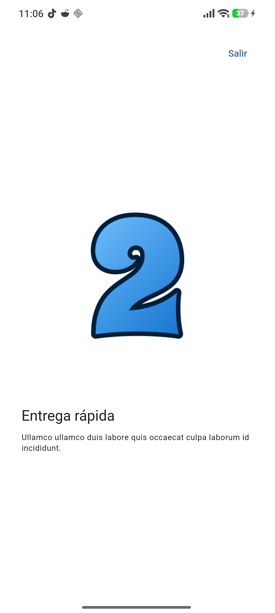
  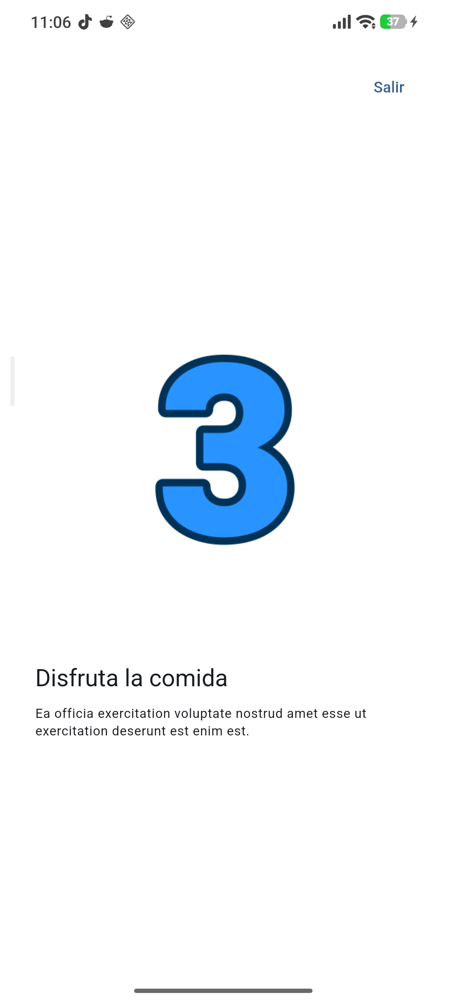

- **Infinite Scroll y Pull to Refresh:** lista de imágenes que agrega elementos
  al desplazarse y se actualiza al arrastrar hacia abajo.

  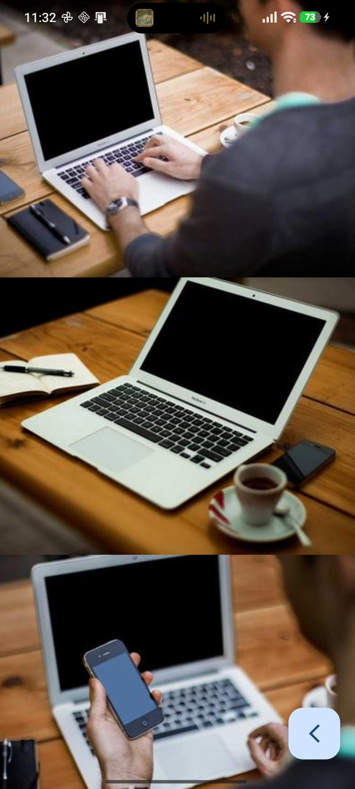

- **Cambiar tema:** selección de color y alternancia entre modo claro y oscuro.

  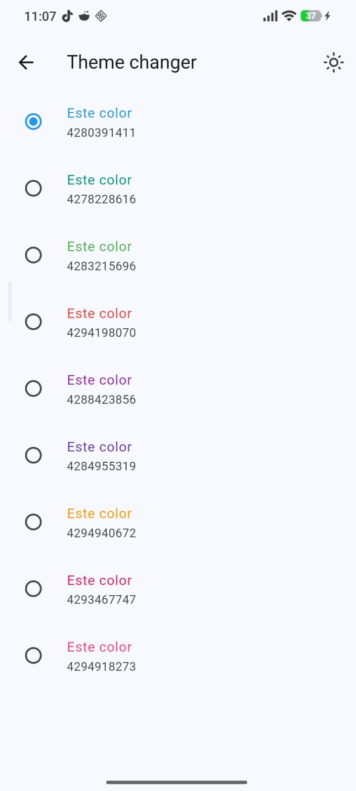
  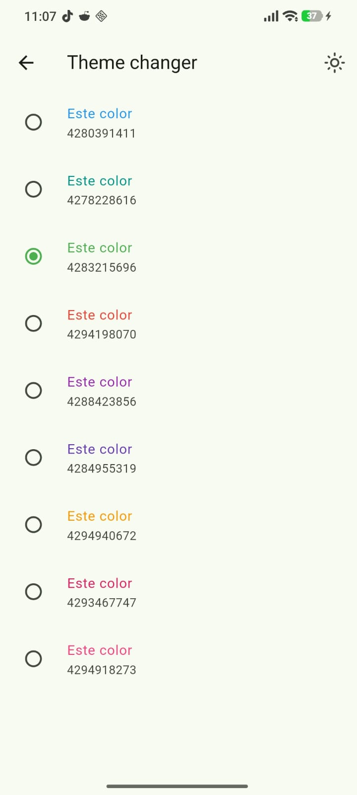
  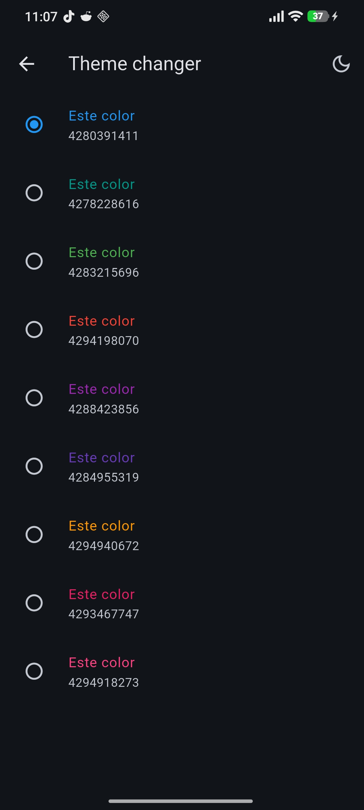

## Tecnologías

- Flutter y Material 3
- `go_router` para la navegación entre pantallas
- `flutter_riverpod` para el estado del contador y del tema
- `animate_do` para animaciones del tutorial y la lista

El selector de tema mantiene su estado en memoria mientras la aplicación está
abierta. Las demostraciones de tarjetas y de desplazamiento infinito descargan
imágenes desde Internet.

## Estructura del proyecto

```text
lib/
├── config/
│   ├── menu/       # Elementos del menú principal
│   ├── router/     # Rutas de la aplicación
│   └── theme/      # Colores y configuración del tema
└── presentation/
    ├── providers/  # Estado con Riverpod
    ├── screens/    # Pantallas de las demostraciones
    └── widgets/    # Componentes compartidos
```

## Requisitos y ejecución

Se requiere tener instalado Flutter y un dispositivo o emulador disponible.
Desde la carpeta `Practica05/widgets_app`, ejecuta:

```sh
flutter pub get
flutter run
```

Para ejecutar las pruebas del proyecto:

```sh
flutter test
```
