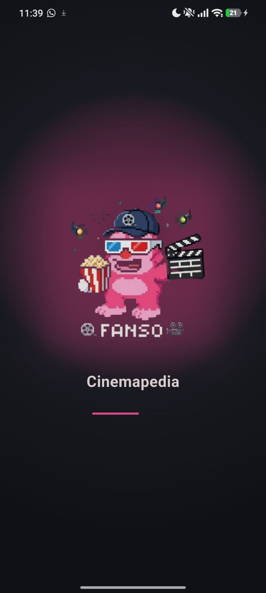
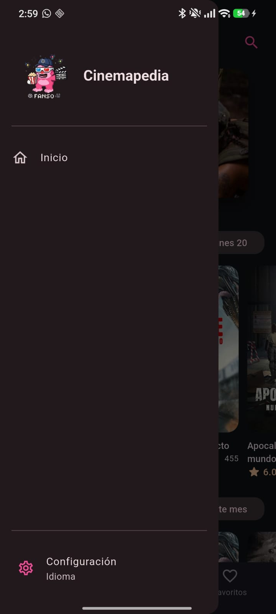
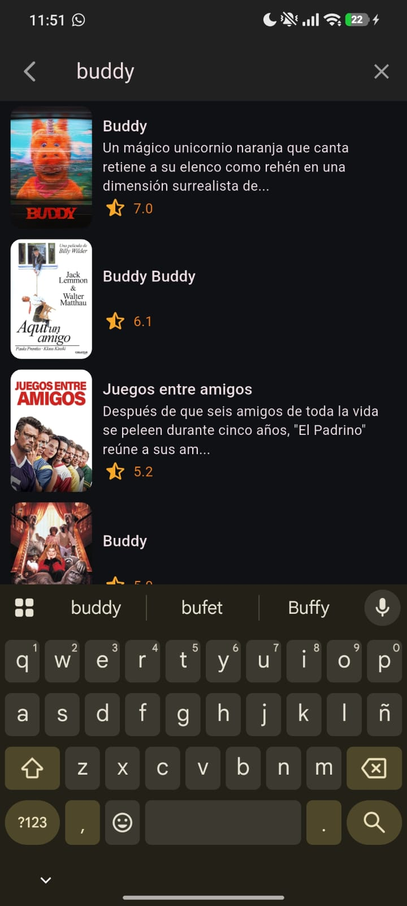
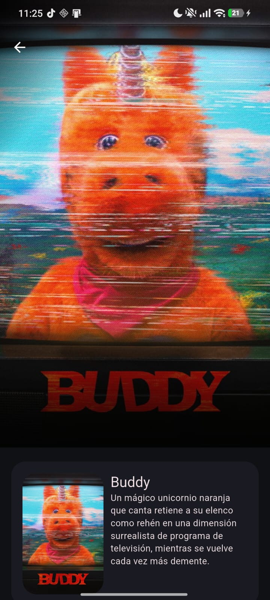
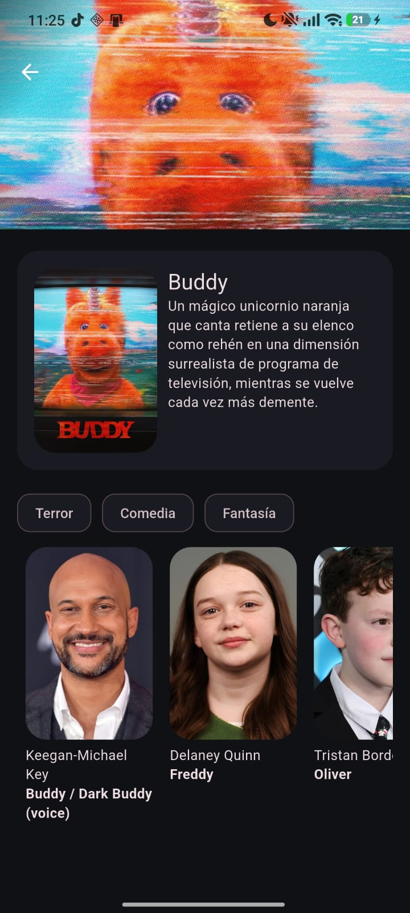
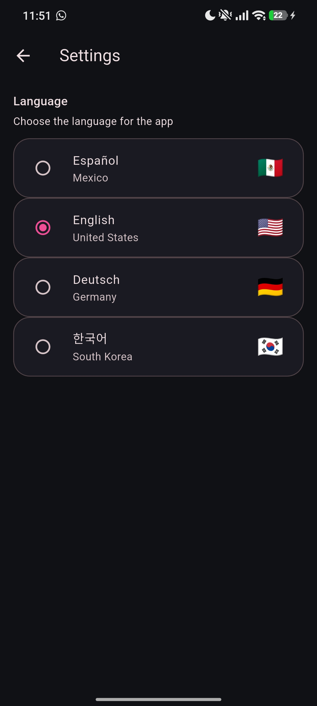
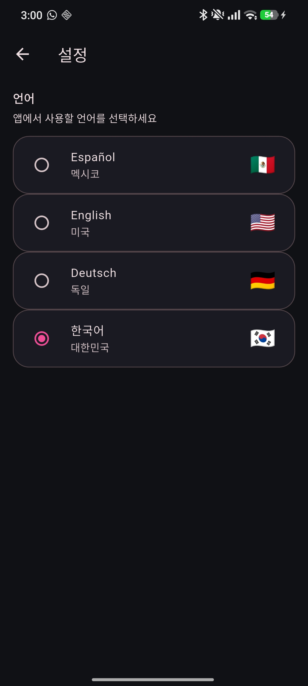
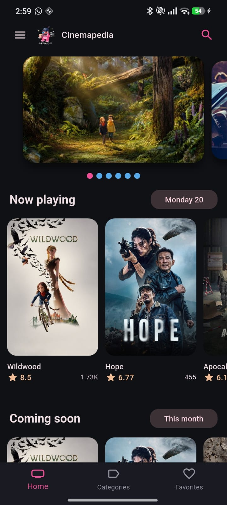
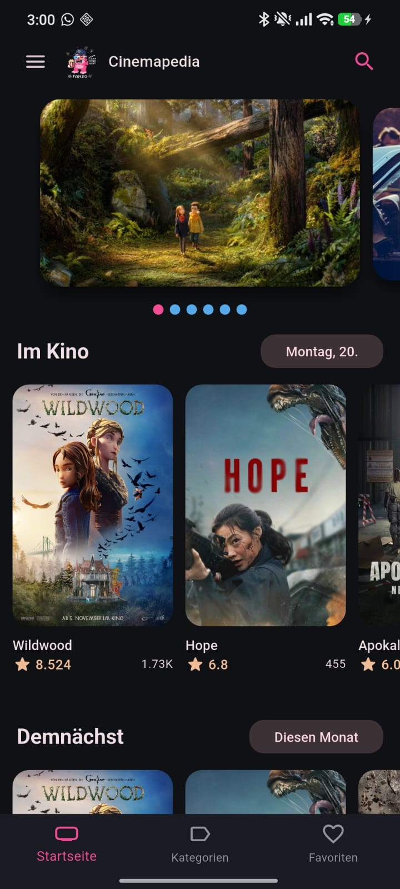
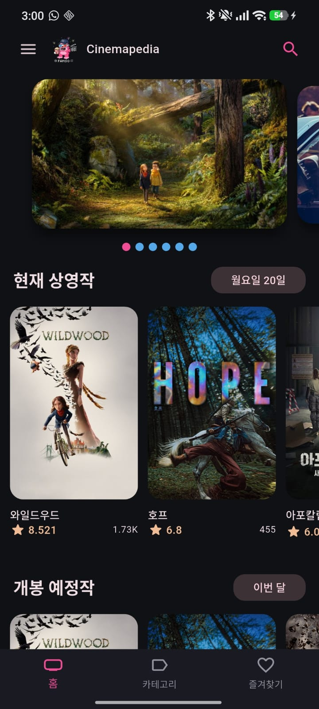

# Práctica 06 — Cinemapedia

Cinemapedia es una aplicación móvil desarrollada con Flutter para explorar películas. La información de películas y reparto se consulta desde [The Movie Database (TMDB)](https://www.themoviedb.org/).

## Funcionalidades

- Catálogos de películas en cartelera, próximas, populares y mejor valoradas.
- Búsqueda de películas y vista de detalles con sinopsis, géneros y reparto.
- Interfaz disponible en español, inglés, alemán y coreano.
- Pantalla de configuración para cambiar el idioma de la aplicación.
- Navegación con `go_router` y estado administrado con Riverpod.

## Arquitectura

- **Diagrama interactivo:** [Abrir en GitHub Pages](https://devfntxy.github.io/Practicas_DMI_230892/Practica06/assets/diagram/diagrama_arquitectura.html).
- **Archivo fuente del diagrama:** [diagrama_arquitectura.html](../assets/diagram/diagrama_arquitectura.html).


### Inicio y navegación

| Pantalla de carga | Menú lateral |
|---|---|
|  |  |

### Búsqueda y detalles

| Búsqueda de películas | Resultados de búsqueda |
|---|---|
|  |  |

| Detalle de película y reparto |
|---|
|  |

### Selección de idioma

La aplicación permite elegir español, inglés, alemán o coreano desde Configuración:

| Español | Inglés |
|---|---|
|  |  |

| Alemán | Coreano |
|---|---|
|  |  |

### Pantalla de inicio por idioma

| Español | Inglés |
|---|---|
|  |  |

| Alemán | Coreano |
|---|---|
|  |  |

### Icono instalado

| Cinemapedia instalada | Icono usado para la aplicación |
|---|---|
|  |  |

## Requisitos

- Flutter SDK compatible con la versión indicada en `pubspec.yaml`.
- Una clave de API de TMDB para cargar datos de películas.

## Configuración y ejecución

Desde la raíz del repositorio, entra al proyecto:

```shell
cd Practica06/cinemapedia
```

Crea un archivo `.env` junto a `pubspec.yaml` con tu clave de TMDB:

```dotenv
THE_MOVIEDB_KEY=tu_clave_de_tmdb
```

Después instala las dependencias e inicia la aplicación:

```shell
flutter pub get
flutter run
```

Para ejecutar las pruebas:

```shell
flutter test
```
